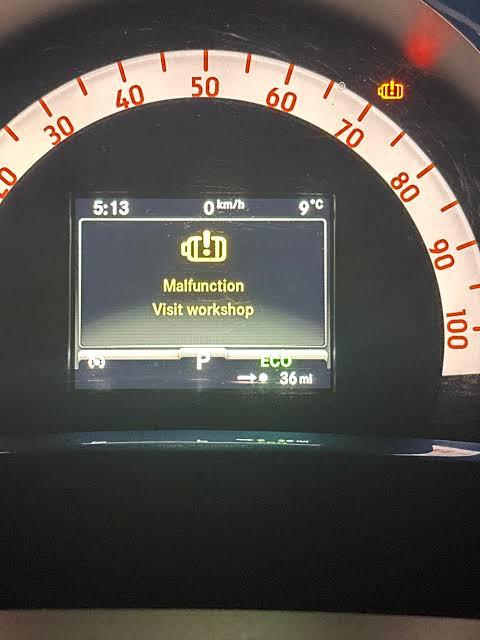

# Smart EQ 453 coolant pump counter
     
Read and reset the driving-mode coolant pump counter, `V_Timer_DrivWEP_ON` (DID `0x3531`), in the **N127 / EVC453** drivetrain control unit. The diagnostic sequence was verified on a **Smart EQ Forfour 453.091**, ECU variant `EVC453_EVC_3180_RH4_810_V2`, with a **DrewTech MongoosePro JLR**.

## Dashboard message and warning lamp

XENTRY fault **`P0463F1`** refers to the driving-mode coolant pump. The dashboard may display **“Malfunction – Visit workshop”** with a **yellow warning lamp**. The same warning can have other causes. Check the exact fault code in N127.



- [Owner's manual for the Smart EQ Forfour, printed page 184](https://moba.i.mercedes-benz.com/markets-smart/ece-row/baix/cars/smart-eq-forfour-453_2018_c/en_GB/downloads/12_17/BA_smart_453_09_AEJ2017-1b_en_GB.pdf)
- [Dashboard photo showing the message and yellow lamp, German display](https://www.smart-emotion.de/wiki/entry/367-was-tun-bei-st%C3%B6rung-werkstatt-aufsuchen/)

## The 10,000-hour service counter

The preventive service threshold reported for this Smart EQ 453 counter is **10,000 pump operating hours (36,000,000 seconds)**. The vehicle tested here had already crossed that threshold when the counter was read. [Smart EQ owner reports](https://www.smart-emotion.de/forum/thread/7996-fehler-p0463f1-kann-wer-mit-ddt4all-im-raum-33100-paderborn-helfen/)

When the operating-hours threshold triggers the message, it acts as a **preventive maintenance warning**. Owners have reported that the old pump can still run and circulate coolant when the warning appears. Confirm the cause before treating the warning as counter-related, and replace the pump and verify circulation before resetting the counter.

The reset writes only the pump operating-hours counter. Pump performance diagnostics and coolant-temperature warnings remain active. A pump fault or overheating can still trigger a warning after a successful reset.

## Usage

Use **32-bit Python 3.8 or later on Windows** and install the DrewTech J2534 driver separately. Connect the Mongoose, turn on the ignition, and close XENTRY. Run these commands with the 32-bit Python interpreter.

```powershell
python .\smart_eq_pump_counter.py --check-driver
python .\smart_eq_pump_counter.py --read
```

**After replacing the pump and verifying coolant circulation**, run the reset. The script saves the original counter value in the current directory, sends one reset request, and reads the counter back.

```powershell
python .\smart_eq_pump_counter.py --reset-after-pump-replacement
```

## Using a different J2534 adapter or DLL

Install the driver from your adapter manufacturer. If it exposes a compatible J2534 04.04 DLL, pass its full path with `--dll`. Match the Python interpreter architecture to the DLL (32-bit Python for a 32-bit DLL). This script currently requires 32-bit Python.

```powershell
python .\smart_eq_pump_counter.py --dll "C:\path\to\vendor-j2534.dll" --check-driver
python .\smart_eq_pump_counter.py --dll "C:\path\to\vendor-j2534.dll" --read
```

An AI coding assistant can help adapt the script. Give it the adapter model, the manufacturer's J2534 documentation, and the driver DLL path and architecture. Ask it to preserve the diagnostic payloads and verify the DLL exports, CAN channel and ISO-TP behavior. Start with `--check-driver` and a successful `--read` on N127 before attempting the reset. A successful DLL load alone does not confirm vehicle communication. Adapters that only expose an ELM327 serial interface need a different transport.

## Verified diagnostic sequence

J2534 ISO 15765 at **500 kbit/s**. CAN request ID **`0x7E4`**, CAN response ID **`0x7EC`**. The bytes below are diagnostic payloads before ISO-TP framing.

| Operation | Request | Positive response |
|---|---|---|
| Read the counter | `22 35 31` | `62 35 31` followed by four bytes |
| Start the extended session | `10 C0` | `50 C0` |
| Reset after pump replacement | `2E 35 31 00 00 00 00` | `6E 35 31` |
| Verify the reset | `22 35 31` | `62 35 31 00 00 00 00` in the vehicle test |

The reset applies only to the pump counter. The tool leaves fault-code memory and the scheduled maintenance reminder unchanged.
